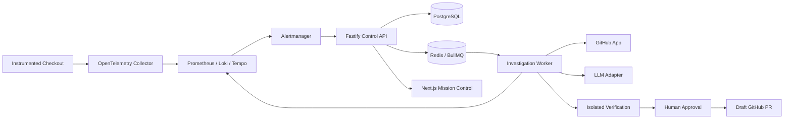

# REANIMATE

**Autonomous incident investigation. Human-approved recovery.**

[](#implementation-status) [](https://kiroween.devpost.com/)

> Project Reanimate stitches Kubernetes, OpenTelemetry, GitHub and AI-driven analysis together to investigate production failures and propose verified remediation PRs.

## The story

A checkout deployment reduces a downstream request timeout from 800 ms to 100 ms. A payment endpoint takes roughly 300 ms. Checkout begins returning 5xx responses. Reanimate observes a real alert, correlates service health with a deployment, reconstructs an evidence-backed incident timeline, proposes a small fix, verifies it in an isolated runner, and creates a **draft PR after human approval**.

## Implementation status

**Foundation scaffold — not yet a finished application.** This initial commit contains the architecture, requirements, Kiro specs, security policies, example observability pipeline, and starter application code. Production integrations, the full AI workflow, and the public judge-facing demo are planned, **not represented as implemented**. See [ROADMAP](docs/ROADMAP.md) and [acceptance checklist](docs/ACCEPTANCE.md).

| Component | Current | Next |
| --- | --- | --- |
| Requirements, decisions, security | Documented | Review, refine |
| API, UI, database, worker | Initial TypeScript scaffold | Install, run and integrate |
| Demo checkout and payment simulator | Instrumented starter | Live smoke tests and failure injection |
| Prometheus / Alertmanager | Example configuration | Validate end-to-end alert ingestion |
| GitHub commit correlation | Designed | Implement |
| AI investigation | Specified | Implement with evidence citations |
| Patch sandbox and pull requests | Specified | Implement with approval and policy gate |
| Kiro Steering / Specs / Hook | Committed | Execute tasks with Kiro and record usage |

## Architecture



The pipeline is evidence-first: a model may propose interpretations and patches but cannot alter production resources or publish changes without explicit approval.

## Workspace

- `apps/web`: Next.js incident workspace (starter)
- `apps/api`: Fastify API, health/readiness, incident and alert routes (starter)
- `apps/worker`: BullMQ evidence collector (starter)
- `packages/contracts`: shared schemas for incident APIs and Alertmanager
- `packages/db`: Drizzle Postgres schema and client
- `packages/incident-engine`: deterministic alert/incident fingerprint helpers
- `demo/checkout-service`: reproducible checkout timeout regression
- `infra/observability`: Prometheus/Alertmanager example configs
- `.kiro`: requirements, technical design, tasks, conventions and hook
- `docs`: product, design, threat model, operations and acceptance criteria

## Quick start (initial scaffold)

**Prerequisites:** Node.js 22+, pnpm 10+, Docker Compose. Dependency install and full runtime validation still need to be performed on a machine with package registry and Docker access.

```bash
node scripts/bootstrap-local.mjs
# Local-only: generated secrets are excluded from Git.
corepack enable
pnpm install
docker compose up -d postgres redis prometheus alertmanager tempo otel-collector
pnpm db:generate
pnpm db:migrate
pnpm dev
```

The documented local monitoring stack is intentionally a **work in progress**: do not interpret `pnpm dev` as a validated complete local one-command environment yet. For the next implementation steps, follow [docs/LOCAL_DEVELOPMENT.md](docs/LOCAL_DEVELOPMENT.md).

## Documentation

- [Product requirements](docs/PRD.md)
- [System architecture](docs/ARCHITECTURE.md)
- [Data model & consistency](docs/DATA_MODEL.md)
- [API contract](docs/API.md)
- [Security and threat model](docs/SECURITY.md)
- [AI investigation contract and evaluation](docs/AI_ENGINE.md)
- [Capacity and operational budgets](docs/CAPACITY_AND_OPERATIONS.md)
- [GitHub issue backlog](docs/GITHUB_ISSUES.md)
- [MVP roadmap](docs/ROADMAP.md)
- [Acceptance and demo rubric](docs/ACCEPTANCE.md)
- [UI design brief](docs/design/INTERFACE.md)
- [Demo/runbook](docs/runbooks/DEMO.md)
- [Architecture decisions](docs/adr/0001-control-plane.md)
- [Kiro usage log](docs/KIRO_USAGE.md)

## Hackathon

**Category:** Frankenstein (Kiroween 2026). **Submission deadline:** 2026-12-04 14:00 PST (2026-12-05 03:30 IST). Official rules: https://kiroween.devpost.com/rules

A public GitHub repository, open source license, functional accessible application, public YouTube demo under 3 minutes, and `.kiro/` at the root are required. Full deliverables are in [docs/ACCEPTANCE.md](docs/ACCEPTANCE.md).

## Repository

Source, Kiro specs and implementation backlog are published at [chandrakantdubey/project-reanimate](https://github.com/chandrakantdubey/project-reanimate). Clone the repository with `git clone https://github.com/chandrakantdubey/project-reanimate.git`, then follow the quick start and open GitHub Issues for milestone progress.

## Security stance

- Read-only Kubernetes / telemetry access by default; GitHub App uses minimal repository permissions.
- Never execute generated shell commands or patches in the API or worker host.
- Sandbox runs without secrets, privileged mode, host mounts or network egress.
- Treat logs, source files and traces as untrusted prompt-injection surfaces.
- No automatic merges, deploys, rollbacks, or `kubectl apply` in MVP.
- Store evidence pointers, redact tokens and personal data before model ingestion.

## License

MIT — see [LICENSE](LICENSE). Third-party components retain their own licenses.
