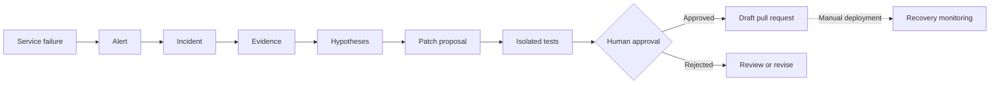

# Project Reanimate

**From production alert to verified fix.**

Reanimate is an AI-powered incident investigation and remediation platform for software engineering and reliability teams. It connects operational telemetry with deployment history and source code, helping engineers understand what broke, why it broke and what change could resolve it — without handing production control to an AI agent.

## Why Reanimate?

An alert tells you that something is wrong, not necessarily why. Engineers must navigate dashboards, traces, logs and repositories, reconstruct a timeline, test hypotheses and translate the diagnosis into a safe change.

Reanimate brings that work into a single evidence-driven incident workspace. Every diagnosis can be challenged, every proposed change can be inspected, and every external write requires explicit authorization.

## Product capabilities

| Capability | Experience |
| --- | --- |
| Incident Lab | Introduce controlled failures into an isolated distributed application and inspect the resulting incidents. |
| Reanimate Shop | Exercise real checkout/payment HTTP calls using synthetic transactions and genuine telemetry. |
| Incident detection | Turn real alerts into durable, deduplicated incident records. |
| Mission Control | Understand affected services, active incidents, severity and integration health. |
| Incident timeline | Connect errors, traces, logs and deployments in chronological order. |
| Evidence explorer | Inspect bounded source excerpts, timestamps, trace identifiers and commit diffs. |
| AI investigation | Review ranked hypotheses, supporting and contradictory evidence, and uncertainty. |
| Remediation review | Inspect a minimal patch, policy checks and isolated test results. |
| GitHub integration | Open a draft pull request after an authorized engineer approves the exact verified change. |
| Incident replay | Explore a recorded investigation in a public read-only environment. |

## From failure to recovery

Reanimate separates observed facts from AI interpretation, test validation from service recovery, and public replay from private live operations. It does not automatically merge code, deploy changes or mutate production clusters.

## Experience Reanimate through Incident Lab

Reanimate Shop is a small working storefront with instrumented checkout and synthetic payment services. Incident Lab introduces controlled faults into this isolated workload, while Reanimate investigates independently from real metrics, logs, traces and deployed source changes.

| Incident | What changes | Expected outcome |
| --- | --- | --- |
| Client timeout regression | Checkout deadline falls from 800 ms to 100 ms; payment remains ~300 ms | Evidence-backed diagnosis, independently tested config correction and authorized draft PR |
| Dependency degradation | Payment latency increases to ~1500 ms; checkout deadline and revision remain unchanged | Distinguish downstream slowdown, recommend next steps and avoid an unsupported patch |
| Missing evidence | A material observability source is unavailable | Explicit uncertainty or abstention |

The first two incidents deliberately produce similar symptoms. The investigator never receives the injected scenario identity or expected answer. Synthetic transactions are not synthetic telemetry: actual requests, failures, alerts, model inference, tests and GitHub operations establish the result.

Explore both recorded investigations in public read-only replay, or run the protected live lab locally. A hosted interactive live lab is a later increment subject to safe isolation.

## Architecture

| Layer | Technology |
| --- | --- |
| Product interface | Next.js, TypeScript |
| Control API | Fastify, Zod |
| Durable state | PostgreSQL |
| Asynchronous investigation | Redis, BullMQ, transactional outbox |
| Telemetry | OpenTelemetry, Prometheus, Loki, Tempo |
| Alert ingestion | Alertmanager |
| Source and deployment context | GitHub App |
| AI reasoning | Provider-neutral structured-output adapter |
| Validation | Isolated, credential-free patch runner |
| Local infrastructure | Docker Compose; optional Kubernetes/Kind |

Reanimate operates outside the application request path. The observability backends remain the source of raw telemetry; PostgreSQL stores incident state and bounded evidence snapshots.

## Documentation

| Area | Document |
| --- | --- |
| Product | [Requirements](docs/PRD.md), [Interface design](docs/design/INTERFACE.md), [Incident Lab and Shop](docs/INCIDENT_LAB.md) |
| Engineering | [Architecture](docs/ARCHITECTURE.md), [Data model](docs/DATA_MODEL.md), [API contract](docs/API.md) |
| Intelligence | [Investigation engine](docs/AI_ENGINE.md) |
| Trust and reliability | [Security](docs/SECURITY.md), [Capacity and operations](docs/CAPACITY_AND_OPERATIONS.md) |
| Development | [Local environment](docs/LOCAL_DEVELOPMENT.md), [Roadmap](docs/ROADMAP.md) |
| Validation | [Acceptance criteria](docs/ACCEPTANCE.md), [Incident Lab runbook](docs/runbooks/DEMO.md) |

Architecture decisions: [Control plane](docs/adr/0001-control-plane.md) · [Durable scheduling](docs/adr/0002-outbox.md) · [Human approval](docs/adr/0003-human-approval.md).

## Status

In development. The capabilities above describe the product scope; the repository currently contains the product and engineering specifications.

## License

[MIT](LICENSE)
