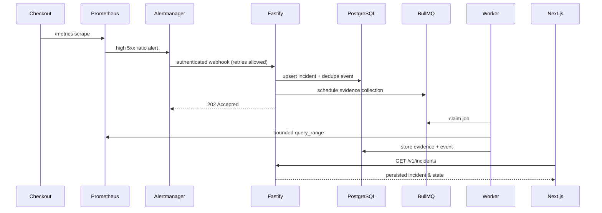
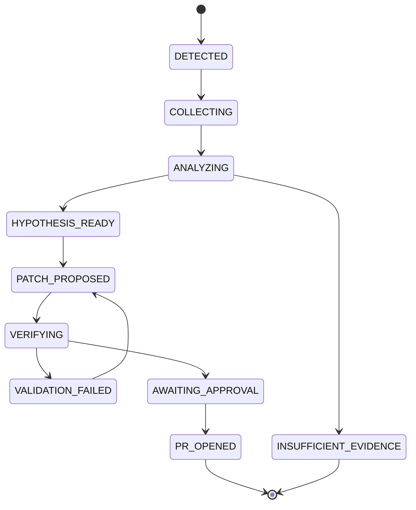

# System Architecture

## Chosen boundaries

**Control plane:** Next.js (browser/UI) -> Fastify (authenticated API) -> PostgreSQL (source of truth) + Redis/BullMQ (transient scheduling) -> worker (evidence and AI). External adapters: Alertmanager, Prometheus/Loki/Tempo, GitHub App, model provider, isolated patch runner.

**Data plane:** checkout service exports traces via OTLP to OTel collector and metrics to Prometheus. Prometheus alerts through Alertmanager. Reanimate **does not** sit on the checkout request path.

### Sequence for the first meaningful slice

**Reliability requirement:** Kiro must implement a transactional outbox in PostgreSQL and a polling dispatcher. A DB-to-queue dual write risks lost scheduling across crashes; see [ADR 0002](adr/0002-outbox.md). No existing scaffold is assumed.

## Correlation strategy

1. Receive authoritative alert fingerprint, `startsAt`, service/environment labels and generator URL.
2. Use source time not webhook arrival time as event time. Normalize all stored timestamps to UTC.
3. Query Prometheus for 15 minutes before and 5 after the alert, with strict time/result budgets.
4. Query Tempo by trace/service/time; resolve selected traces with 5xx spans and downstream timeout statuses.
5. Query Loki by service and trace ID, with max bytes and line count; keep redacted bounded excerpts.
6. Look up latest deployment SHA and GitHub Compare API; score candidate changes with temporal proximity + touched service files + diff content.
7. Create a dependency graph: signals, traces, deploys, commits, hypotheses with source-specific confidence.
8. Ask LLM for hypotheses using **only** a JSON bundle of signed/hashed evidence references and permitted code context.
9. Require concrete supporting and contradicting IDs; fail closed when evidence is missing.

**Do not claim causation from correlation alone.** A suspect commit must be checked against the affected code path and tests.

## Investigation workflow / finite states

The incident has a *separate* lifecycle (`firing`, `acknowledged`, `resolved`); a resolved incident may still have a pending PR.

## Deployment topology

- **Local:** PostgreSQL, Redis, Prometheus, Alertmanager, OTel collector and simulated checkout via Docker Compose; Node processes via pnpm for hot reload. Kind is optional for Kubernetes event correlation.
- **Judge-facing:** frontend and read-only API backed by a curated incident replay, without service credentials or arbitrary execution access.
- **After MVP:** separate private control API, worker with network isolation, managed Postgres/Redis, restricted GitHub App installation and model gateway. Cloud deploy is explicit opt-in.

## Failure and resilience patterns

| Failure | Behavior |
| --- | --- |
| Repeated/out-of-order alert webhooks | unique dedupe event key and state transition guard |
| DB down | 503; Alertmanager retries, do not acknowledge delivery |
| Redis down | outbox remains pending; dispatcher retries with jitter |
| Metrics backend down | record gap, partial evidence, mark hypothesis uncertain |
| LLM 429/timeout | bounded retries with jitter + request budget, no fabricated RCA |
| GitHub rate limiting | respect Retry-After; retain pending approval job |
| Duplicate PR trigger | unique proposal key and GitHub branch name; look up existing PR before create |
| Worker crash mid-operation | idempotent jobs, leases and reconciliation |
| Client disconnect | server state in Postgres; replayable events on reconnect |
| Unexpected model output | Zod schema validation; reject unreferenced evidence IDs |

## Scale and capacity assumptions

MVP: 1–5 services, 100–1000 RPS synthetic traffic, 1 alert episode/minute, 1–5 concurrent investigations. Each incident collects at most 200 trace spans, 400 log lines and 10 metrics series into bounded evidence snapshots. A typical investigation should stay below 100 KB curated textual context; raw telemetry lives in its backend, not the Postgres incident row.

At 1000 incidents/day with 200 KB evidence metadata/snapshots each: roughly 200 MB/day logical data before indexes/replication (illustrative). Retention: evidence snapshots 14 days by default, audit trail 90 days, summaries 90 days; configurable with privacy requirements. Redis is not authoritative.

For 10x scale: separate alert ingestion from investigation, shard queues by tenant/project, use per-provider token buckets, batch telemetry lookups and cache immutable GitHub commit diffs. Postgres unique indexes enforce idempotency. Multi-region architecture is deferred; if introduced, choose one home region for each project to avoid split-brain writes; cross-region read-only replicas and backups provide recovery.

## UI data delivery

REST for durable CRUD, cursor-paginated incident lists. SSE for per-incident progress (`Last-Event-ID` and monotonically increasing event sequence), with polling fallback. Webhooks and worker events must never be the only data source for the UI.
