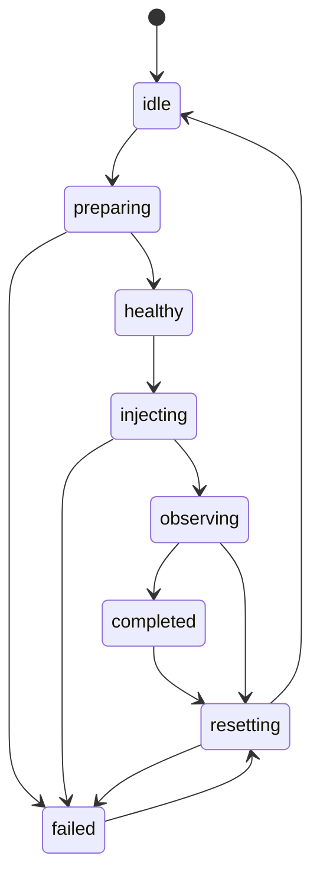

# Incident Lab and Reanimate Shop

## Purpose

Reanimate Shop is a small, instrumented reference application used to demonstrate and evaluate Reanimate against real service failures. Incident Lab is a protected control surface that operates this isolated workload. Neither is a payment gateway or a dependency of the production investigation engine.

The initial product must distinguish two incidents with similar symptoms but different causes. A genuine, verified remediation PR is required for the configuration regression; a correct diagnosis and appropriate abstention from automated patching are required for dependency degradation.

## Reference application

| Component | Responsibility |
| --- | --- |
| Storefront | Browse a small product catalog, submit a synthetic checkout, view actual order outcome |
| Checkout API | Validate request, call payment over HTTP with a real deadline, return success or a gateway timeout |
| Payment service | Process synthetic payment requests with controllable latency; emit server-side telemetry even when caller times out where observable |
| Traffic generator | Bounded repeatable synthetic checkout requests with unique IDs |
| Lab controller | Start, reset and apply allowlisted scenarios to a dedicated environment; record private ground truth for evaluation |

No real cards, payment credentials, customer PII, external payment processors or financial transactions. Use synthetic IDs and amounts; if payment outcome is persisted, enforce idempotency and distinguish timeout/unknown from confirmed failure. Inventory and additional services are optional, not critical-path requirements.

## Scenario catalog

| ID (private evaluator only) | Healthy baseline / injected change | Observable behavior | Expected outcome |
| --- | --- | --- | --- |
| A — Client regression | Payment ~300 ms; actual deployed checkout config changes 800 ms to 100 ms | Checkout deadline failures, payment server latency near baseline, deployed SHA/diff changes | Identify client timeout regression; propose a policy-checked restoration to evidenced known-good value; verify and open authorized draft PR |
| B — Dependency degradation | Checkout remains 800 ms; payment latency changes from ~300 ms to ~1500 ms via private lab control | Similar checkout deadline failures; payment server latency increases; checkout revision unchanged | Identify downstream slowdown; explain evidence and recommend investigating/recovering dependency; no automatic timeout increase or unrelated PR |
| C — Evidence gap (required negative test) | Withhold a material source needed to distinguish A/B | Same symptom, incomplete source coverage | Explicit uncertainty or insufficient_evidence; no unsupported patch |
| D — Application regression (P1) | Deploy a scoped code defect producing 5xx | Real exception and changed code path | Evidence-backed diagnosis; remediation only if policy and validation support it |

Scenario A and B are P0. Scenario C is an acceptance/evaluation condition, not an additional infrastructure build. A new incident scenario is not required for P0 code remediation beyond A.

## Blind investigation contract

- The lab controller, evaluation harness and scenario definitions are outside investigator permissions and model context. Ground truth is accessible only to authorized lab/evaluation roles and revealed for scoring after an investigation completes.
- Neither fault name, expected answer, private control event, fixture identifier, scenario-specific route, nor evaluator result may enter alert labels, retrieved evidence metadata, model prompts, candidate ranking, patch selection or investigator-visible repository context.
- Use the same generic alert rule, neutral service/environment identifiers, trace/log fields, evidence retrieval and model pipeline across cases. Evidence of actual behavior and actual deployed config/diff is allowed and necessary.
- Do not point the model at the full Reanimate development repository, scenario catalog or test oracle. Restrict repository context to the monitored workload's deployed revisions and bounded relevant code. Use a dedicated GitHub target repository seeded reproducibly from included reference workload source; avoid descriptive fault branch names and commit messages that disclose the evaluation answer.
- The controller may know which revision to deploy or latency to set; the investigator may only read independently observed service state, telemetry and genuine deployment metadata.
- Evaluate both scenarios in randomized order with clean baselines and fresh alert episodes. Include an unrelated change and a missing-source case. Record evidence coverage, correctness, abstention, time and model cost. No claim of general production RCA accuracy follows from this small evaluation.

## Operational lifecycle

A single active run per isolated environment is sufficient. Use a durable run ID, lease/fencing or equivalent serialized ownership, bounded traffic rate and duration, readiness checks, timeouts and reset/cleanup. Prevent concurrent conflicting starts. Expired leases trigger cleanup/reconciliation, not unbounded load. Start with local Docker Compose and optional authenticated remote lab only after isolation is verified.

The lab controller can mutate only preconfigured test services through narrow, predefined actions. It never accepts arbitrary commands, hosts, images, Git refs or target repositories from visitors. It must not expose Docker sockets, production credentials or mutation capability to the investigator, browser or public replay. Reset restores a known healthy revision and latency, stops traffic and waits for resolved alerts before the next run.

## Deployment provenance and telemetry

Use an actual source revision, image/build provenance and deployment observation for scenario A. Record deployed SHA, service, environment, timestamp and release identity; a commit timestamp alone is not deployment evidence. Prefer a prebuilt pair of known revisions to minimize injection time. Scenario B must not alter checkout revision; record independent payment latency metrics and server spans/logs with trace correlation. Use generic event labels that do not identify the scenario.

Instrument checkout request counts, duration and errors plus payment request counts and server processing duration; propagate trace context over HTTP. Capture representative server-side measurements even when checkout cancels. Use explicit metric units, bounded labels and an alert with a minimum request count/rate so idle traffic is not a false healthy/failing signal. Preserve evidence before/after the regression and display missing samples honestly.

## Remediation

Use a structured action such as update_config with allowlisted path/key, expected current value, proposed value and supporting evidence IDs. The deterministic engine checks the actual base revision and current value and materializes the diff. Derive the restoration from evidenced baseline rather than hardcoding the answer in investigator logic. Run independent regression tests on the original and patched revisions in a credential-free, network-denied runner; original must fail the targeted assertion and patched must pass it plus mandatory safety checks. If preconditions fail, withhold remediation.

An operator approves the exact verified diff, then separately requests a genuine draft PR in the dedicated workload repository. Manual deployment and measured recovery are separate, P1 capabilities.

## Public access

Public P0 experience: an interactive, read-only replay for both recorded incidents, including evidence, hypotheses, validation/PR receipts where applicable and clear replay labels. A hosted live lab is P1 only if sandbox/session isolation, rate limits, cost caps, TTL cleanup and abuse prevention are proven. No anonymous GitHub writes or arbitrary execution. If shared infrastructure is insufficient, provide local authenticated live lab plus public replay rather than unsafe public controls.

See [product requirements](PRD.md), [security](SECURITY.md), [acceptance criteria](ACCEPTANCE.md) and [scenario runbook](runbooks/DEMO.md).
